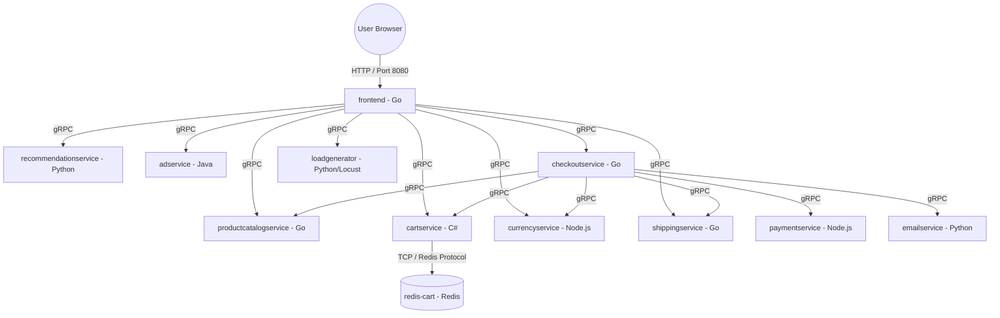

# Google Online Boutique (Microservices Demo)

Welcome to the local development and architecture documentation for **Online Boutique**! This project provides a practical hands-on environment for exploring microservices patterns, Kubernetes deployments, gRPC inter-service communication, and resilience testing.

---

## 1. About the Project

### What is Online Boutique?
**Online Boutique** is a cloud-native microservices demonstration application. It simulates an e-commerce website where users can browse products, add items to a shopping cart, select different currencies, view tailored product recommendations, receive context-aware ads, and complete a mock checkout process.

The application consists of **11 microservices** written in multiple programming languages (Go, C#, Python, Node.js, and Java) that communicate with each other over **gRPC** protocols, alongside an in-memory **Redis** cache for shopping cart persistence.

### Origin & Credit
* **Original Repository:** [GoogleCloudPlatform/microservices-demo](https://github.com/GoogleCloudPlatform/microservices-demo)
* **Author / Maintainer:** Google Cloud Platform (GCP) Engineering Team
* **License:** Apache 2.0

This project is widely used across the cloud-native community to showcase Kubernetes concepts, service meshes (Istio/Linkerd), observability, continuous delivery, and microservices architecture best practices.

---

## 2. Microservices Architecture at a Glance



### Core Architecture Highlights
* **Entry Point:** `frontend` (Go) serves HTTP web pages and translates client requests into downstream gRPC requests.
* **Stateful Component:** `cartservice` (C#) uses `redis-cart` (Redis) for key-value cart state persistence. All other microservices are strictly stateless.
* **Communication Protocol:** Inter-service backend requests run on high-performance **gRPC** over protocol buffer schemas (`.proto`).

Detailed service breakdown, port mappings, and dependencies can be found in [`docs/architecture.md`](docs/architecture.md).

---

## 3. Local Setup Instructions (Kind)

Follow these exact steps to run the complete microservices stack locally inside a [Kind](https://kind.sigs.k8s.io/) (Kubernetes in Docker) cluster.

### Prerequisites
* [Docker Desktop](https://www.docker.com/) (running with at least 4GB RAM allocated)
* [kubectl](https://kubernetes.io/docs/tasks/tools/)
* [kind](https://kind.sigs.k8s.io/docs/user/quick-start/#installation)

---

### Step 1: Create the Local Kubernetes Cluster
Spin up a local Kind cluster named `boutique`:

```bash
kind create cluster --name boutique
```

Verify that the cluster context is active:
```bash
kubectl cluster-info --context kind-boutique
kubectl get nodes
```

---

### Step 2: Deploy the Application

1. Create the dedicated `boutique` namespace:
   ```bash
   kubectl create namespace boutique
   ```

2. Apply all Kubernetes deployment and service manifests:
   ```bash
   kubectl apply -f ./upstream-release -n boutique
   ```

---

### Step 3: Check Deployment Status
Wait for all microservice pods to transition into the `Running` state (this may take 1–3 minutes while images download):

```bash
kubectl get pods -n boutique -w
```

Verify that all pods show `STATUS: Running` and `READY: 1/1` (or `2/2`).

---

### Step 4: Access the Application UI
Forward local port `8080` to the frontend service deployment:

```bash
kubectl -n boutique port-forward deployment/frontend 8080:8080
```

Open your browser and navigate to:
```text
http://localhost:8080
```

You can now browse products, select currencies, add items to the cart, and complete mock orders!

---

## 4. Teardown Instructions

To delete the cluster and remove all local resources created during your session, run:

```bash
kind delete cluster --name boutique
```

Confirm that the cluster has been removed:
```bash
kind get clusters
```

---

## 5. Resilience & Fault-Tolerance Experiments

You can test how the application responds when individual microservices experience downtime or pod restarts:

1. **Non-Checkout Path Failure (e.g., `adservice`):**
   ```bash
   kubectl -n boutique scale deployment/adservice --replicas=0
   ```
   *Observe:* The frontend loads cleanly, but advertisement banners degrade gracefully without breaking page load.

2. **Critical Path Failure (e.g., `paymentservice`):**
   ```bash
   kubectl -n boutique scale deployment/paymentservice --replicas=0
   ```
   *Observe:* Browsing works normally, but placing an order during checkout returns a graceful error.

3. **Pod Self-Healing & Recovery:**
   ```bash
   kubectl -n boutique delete pod -l app=productcatalogservice
   ```
   *Observe:* Kubernetes automatically schedules a replacement pod, and service resumes as soon as readiness probes succeed.
